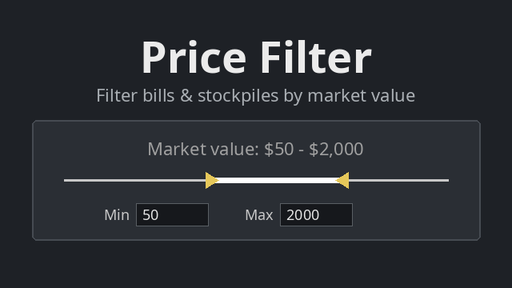

# Price Filter



A RimWorld 1.7 mod that adds a **market value filter** next to the vanilla hit points and quality filters.

Want your cremation bill to burn only low-value corpses? Your smelter to ignore valuable weapons? A stockpile that only accepts items worth more than $500? Set a min/max price and you're done.

## Features

- **Bills and stockpiles**: a market value slider appears in every item filter (bills, storage, shelves, apparel policies).
- **Precise control**: two-handle slider (fine steps on low values) plus exact Min/Max input. Empty = no limit.
- **Per-unit value**: uses the market value shown in the info card. Minified furniture uses the inner item's value.
- **Save-friendly**: saved with your game, kept on copy/paste and bill duplication. Removing the mod does not break saves.
- **Language option**: English by default, French available (Mod settings → Price Filter).

## Installation

**Requires [Harmony](https://steamcommunity.com/sharedfiles/filedetails/?id=2009463077).**

1. Download this repository (Code → Download ZIP) or the latest release.
2. Extract it into your `RimWorld/Mods/` folder.
3. Enable **Harmony**, then **Price Filter** below it.

The compiled mod (`Assemblies/PriceFilter.dll`) is included, no build needed.

## Compatibility

- RimWorld **1.7** only.
- Works with any mod that uses vanilla item filters. Mods that replace the filter UI entirely may not show the slider.

## Building from source

Requires the .NET 10 SDK.

```bash
cd Source/PriceFilter
dotnet build -c Release
```

The DLL is written to `Assemblies/`. See [BUILD.md](BUILD.md) for the code structure.

## License

[MIT](LICENSE)

## Support

If you enjoy this mod, you can support its development:

[](https://www.paypal.com/donate/?hosted_button_id=P5SMYTGS8J52J)
